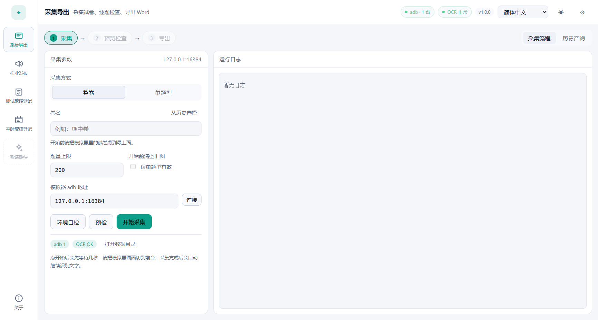
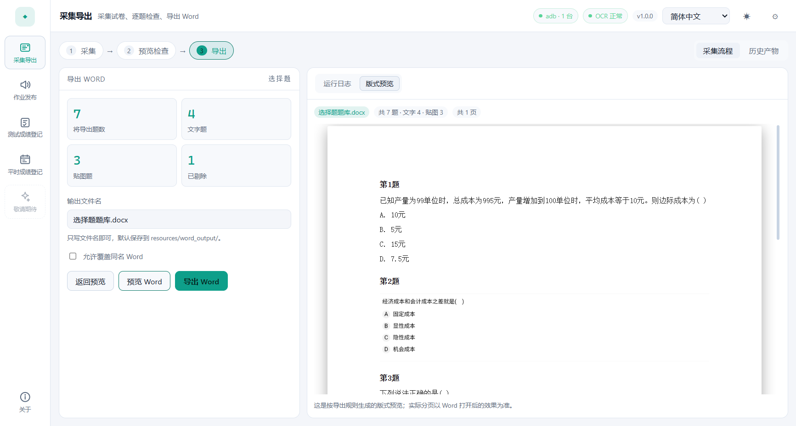
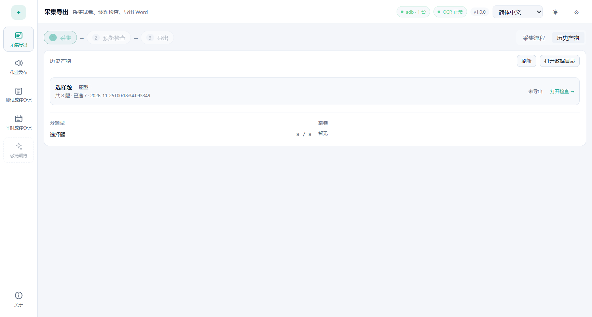
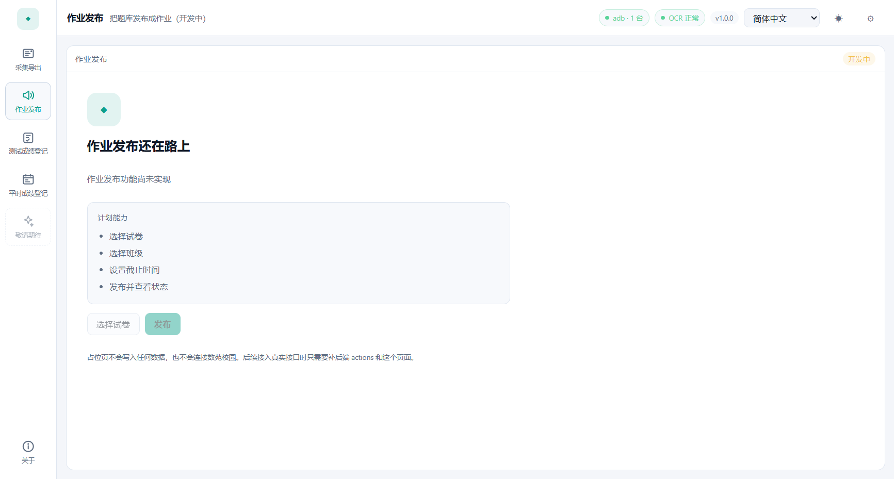
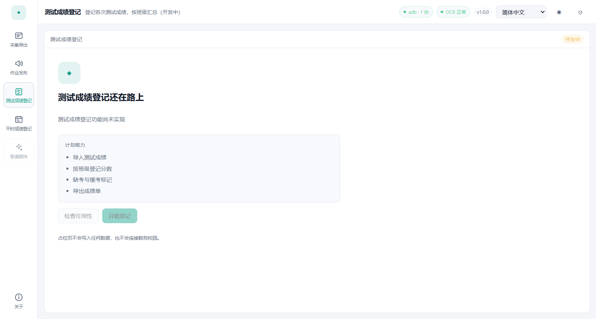
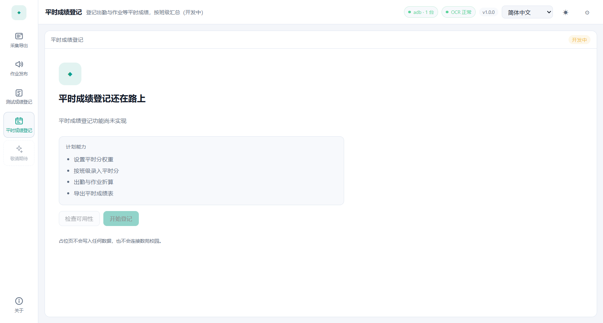
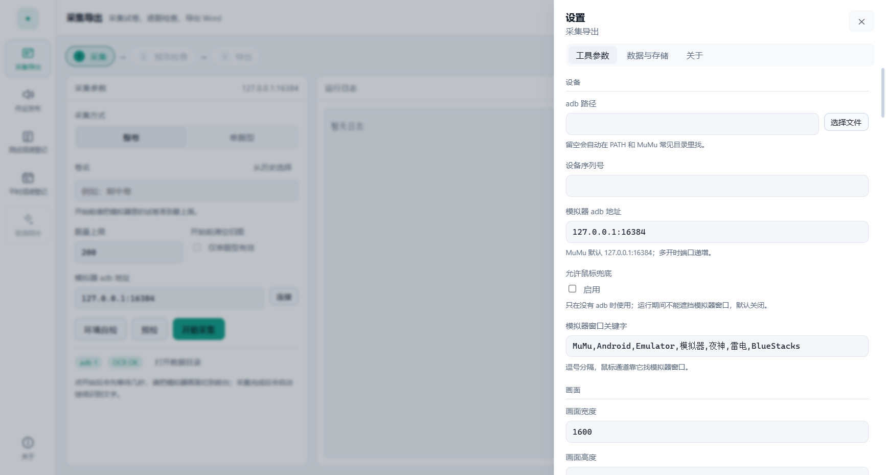

# 数苑校园工具包（Sciyardcampus Kit）

> 版本 **1.0.0** · Windows 桌面应用 · MIT License

把「数苑校园」试卷预览里的题目从安卓模拟器**采集下来**，逐题检查、可编辑文字，
再按每题选择「文字 / 图片」导出成 Word 题库。


## 1. 简介

数苑校园的试卷只在 App / 网页里能看，想整理成可编辑的题库要一题题截图、抄写。
本工具把这条流水线放到桌面上：

```text
MuMu 模拟器（数苑校园 App，试卷预览页）
  → adb 自动滚动截屏，按「（x分）」红色标题行切题
  → Tesseract 自动 OCR，公式 / 表格 / 图像题打标签
  → 预览检查：看原图、改文字、剔除、单题重识别、按题号定位
  → 每题决定 Word 里用文字还是图片，导出前可整页预览
  → 生成 Word 题库，历史产物可随时回来接着改
```

特点：

- **全程离线**：图片、文字、Word 都只留在本机，不上传网络；
- **可中断、可续做**：采集 / OCR / 导出都是后台任务，有进度、日志、取消；
  检查会话落盘，关掉应用再打开还在；
- **所见即所得**：预览里的勾选与「文字 / 图片」选择就是导出内容，导出前还能预览版式；
- **插件式工具**：采集导出、作业发布、测试成绩登记、平时成绩登记共用一套外壳与注册表。

本工具是 [Sciyardcampus_file_export](https://github.com/FantasySilence/Sciyardcampus_file_export)
的桌面版：切题 / OCR / Word 算法沿用上游，界面换成 pywebview + Vue 3。
归属与许可见[第 9 节](#9-归属与许可)。

## 2. 工具一览

| 工具 | 状态 | 说明 |
|---|---|---|
| 采集导出 `export` | ✅ 可用 | 采集 → 自动 OCR → 预览检查 → 导出 Word → 历史 |
| 作业发布 `publish` | 🚧 占位 | 页面 + 后端插件骨架，`check` 返回 `NOT_IMPLEMENTED`，不写任何数据 |
| 测试成绩登记 `exam_scores` | 🚧 占位 | 同上 |
| 平时成绩登记 `regular_scores` | 🚧 占位 | 同上 |

左栏工具图标下方的「敬请期待」是后续工具的入口占位，点击只提示，不做任何操作。

## 3. 环境要求

| 项目 | 要求 | 说明 |
|---|---|---|
| 操作系统 | Windows 10 / 11 | 依赖 WebView2 与 Win32 窗口 / DPI 接口 |
| WebView2 | Microsoft Edge WebView2 Runtime | Win11 一般已自带；缺失时应用会提示 |
| 模拟器 | MuMu 模拟器 12 | 画面 **1600×900**、DPI 240、横屏 |
| OCR | Tesseract 5.x + `chi_sim` / `eng` 语言包 | 外部依赖，安装后在设置里指定路径 |
| Python（源码运行） | 3.12（开发使用 3.12.7） | exe 运行不需要 Python |
| Node.js（改前端 / 打包） | 20+ | 只在开发时需要 |

Tesseract 下载：<https://github.com/UB-Mannheim/tesseract/wiki>，
安装时勾选 **Chinese (Simplified)**。

## 4. 安装与运行

### 4.1 直接运行 exe

```text
dist\Sciyardcampus_Kit\Sciyardcampus_Kit.exe
```

`Sciyardcampus_Kit.exe` 与 `_internal\` 必须放在**同一个文件夹**，
不要单独拷 exe。exe 不依赖本机 Python / Node，但 Tesseract 仍是外部依赖。

### 4.2 源码运行

```powershell
cd D:\GitsProject\Sciyardcampus_Kit

# 1. 虚拟环境（已有可跳过；必须 Python 3.12）
py -3.12 -m venv .venv
.venv\Scripts\python.exe -m pip install -r requirements-dev.txt

# 2. 前端（首次或改前端后）
cd web
npm install
npm run build
cd ..

# 3. 启动
.venv\Scripts\python.exe main.py
```

开发热更新：

```powershell
# 终端 1
cd web; npm run dev

# 终端 2
.venv\Scripts\python.exe main.py --dev --debug
```

### 4.3 命令行参数

```powershell
.venv\Scripts\python.exe main.py --data-dir "D:\some\data"   # 自定义数据目录
.venv\Scripts\python.exe main.py --dev --debug               # Vite 热更新 + 开发者工具
```

## 5. 模拟器准备

1. 安装 MuMu 模拟器 12，设置 → 显示：分辨率 **1600×900**、DPI **240**、横屏；
2. 登录数苑校园，打开要采集的**试卷预览页**；
3. 应用内点「连接」（默认 `127.0.0.1:16384`），顶栏 `adb` 状态灯变绿即可；
4. 重启模拟器后 adb 连接会失效，需要重新点「连接」。

adb 不用单独装：应用按「设置里的路径 → `PATH` → MuMu 常见安装目录」的顺序自动查找。

## 6. 工具详解

### 6.1 采集导出 `export`

#### 第 ① 步：采集



1. 选**整卷**或**单题型**：
   - 整卷：填卷名，从试卷最上面开始一路滚到底；
   - 单题型：选题型（题型列表在设置里可改），从该题型第一题开始；
2. 填**题量上限**（整卷题多时给大一些，截到底会自动停）；
3. 点「**预检**」可以先截一屏，看识别框和题号对不对；
4. 点「**开始采集**」。开始后会先等待几秒（预热），请把模拟器画面切到前台；
5. 采集完会**自动接着 OCR**。同一时刻只允许一个任务，重复点会提示任务占用。

右侧「运行日志」实时输出每一步；任务可以随时取消，已采到的题会保留。

#### 第 ② 步：预览检查


左栏是题目列表，右栏是当前题详情：

| 功能 | 用法 |
|---|---|
| **网格 / 条目** | 网格看图快，条目看文字快；选择记在本地 |
| **按题号定位** | 输入 `35` 或 `第35题` 回车，自动翻页、选中、滚到可见 |
| **全选 / 全不选** | 批量勾选 / 取消勾选（导出只包含勾选的题） |
| **批量呈现方式** | 「全部文字」「全部图片」一键把整卷改成同一种方式 |
| **单题呈现方式** | 详情里的色块卡片：文字=青色、图片=琥珀色，写明将如何进入 Word 及原因 |
| **文字编辑** | 直接改「OCR 文字」，停顿 700ms 自动写回 txt；切题 / 离开 / 导出前强制保存 |
| **重新识别** | 对识别效果差的题单独再跑一次 OCR |
| **剔除** | 卡片右上角勾选按钮；剔除的题不会写进 Word，也不会删除图片和文字 |
| **查看原图** | 打开该题的原始截图文件 |

顶部统计会实时更新：总题数、已选、文字 / 贴图各多少、需核对（带公式 / 表格 / 图像标签）、已剔除。

#### 第 ③ 步：导出 Word



1. 确认**输出文件名**（默认 `resources/word_output/<卷名>.docx`）；
2. 点「**预览 Word**」：右侧按 A4 分页显示将要导出的内容，含每页页码、
   跳过 / 回退提示；预览只读，不会生成文件；
3. 同名文件存在时需要先勾选「**允许覆盖同名 Word**」；
4. 点「**导出 Word**」，完成后可直接打开文件或所在目录。

呈现规则（与上游一致）：

- `auto`：有 formula / table / image 标签 → 贴原图，否则 → 转正文；
- `text`：强制读 txt 写正文；
- `image`：强制贴 png；
- 缺文件时互相回退并在日志里提示。

#### 历史产物



- 有检查会话的产物：点「打开检查」直接回到预览检查，继续改完再导出；
- 只有图片 / 文字的旧产物：打开时现场合成只读会话，同样可以预览和导出；
- 下半部分是目录清单（分题型、整卷各多少张图 / 多少份文字）。

### 6.2 作业发布 `publish`（占位）



本期只有页面与后端插件骨架：不写数据、不弹假成功，按钮全部禁用。
后续计划：选试卷 → 选班级 → 设置截止时间 → 发布并查看状态。

### 6.3 测试成绩登记 `exam_scores`（占位）



计划能力：导入测试成绩、按班级登记分数、缺考与缓考标记、导出成绩单。

### 6.4 平时成绩登记 `regular_scores`（占位）



计划能力：设置平时分权重、按班级录入平时分、出勤与作业折算、导出平时成绩表。

### 6.5 设置



点右上角 ⚙ 打开设置抽屉，分三页：

- **工具参数**：当前工具的全部可调参数（设备、画面、题卡识别、OCR、Word 版式…），
  有范围校验，保存后立即生效；「恢复默认」只对这一页生效；
- **数据与存储**：查看 / 更改数据目录、打开目录、恢复默认位置；
- **关于**：版本、技术栈、许可证与仓库地址。

## 7. 数据与配置

默认数据目录：

- **源码运行**：仓库根目录；
- **exe 运行**：exe 所在目录。

```text
<数据根>/
├─ resources/
│  ├─ row_pngs/<题型>/*.png      采集到的题目原图
│  ├─ row_txt/<题型>/*.txt       OCR / 手改后的文字
│  ├─ row_paper/<卷名>/pngs|txts 整卷产物
│  └─ word_output/*.docx         导出的 Word
└─ .scikit/
   ├─ settings/                  工具设置与偏好
   ├─ backups/                   设置自动备份（保留 5 份）
   ├─ sessions/                  检查会话（预览与导出的唯一数据源）
   ├─ probe/ thumbs/ tmp/        预检图、缩略图缓存、OCR 临时文件
   └─ webview/                   WebView2 缓存
```

数据目录可以自定义，优先顺序：

1. 命令行 `--data-dir`;
2. 环境变量 `SCIYARDKIT_DATA_DIR`；
3. exe 同级 `portable.json`：`{"dataDir": "..."}`；
4. 设置里「更改位置」记录到用户目录；
5. 默认：应用目录。

换目录时 `resources/` 与 `.scikit/` 会一起搬走；也可以直接指向已有的
`Sciyardcampus_file_export` 项目目录，复用其中现成的题目。

## 8. 面向开发者

### 8.1 技术栈

| 层 | 选型 |
|---|---|
| 桌面外壳 | [pywebview](https://pywebview.flowrl.com/) 6 + WebView2（pythonnet） |
| 前端 | Vue 3 + TypeScript + Vite，纯 CSS 设计 token，无 UI 框架 |
| 后端 | Python 3.12，标准库 + Pillow / numpy / python-docx |
| 识别 | Tesseract 5（外部进程，`chi_sim`） |
| 截图 / 操作 | adb（默认）或 PyAutoGUI + PyGetWindow（显式开启的兜底） |
| 打包 | PyInstaller onedir |
| 质量 | pytest（61 项）、ruff、vue-tsc |

### 8.2 架构

```text
Vue 组件
  └─ bridge.ts（invoke / callTool）
       └─ window.pywebview.api ──→ scikit/api.py（js_api 门面，统一信封）
            └─ Registry.call(tool, action, payload, ctx)
                 └─ tools/<id>/actions.py
                      ├─ jobs.py（后台任务：进度 / 日志 / 取消 / 互斥）
                      ├─ session.py（检查会话）
                      └─ pipeline/（pipeline 不碰 UI、不读设置，只吃参数）
```

目录：

```text
Sciyardcampus_Kit/
├─ main.py                      入口：把 src/ 加进 sys.path，调用 scikit.app.run()
├─ src/scikit/
│  ├─ const.py                  全项目唯一常量表（默认值 / 路径 / 设备 / 算法 / 设置范围）
│  ├─ app.py                    窗口、本地 HTTP、/media 路由、WebView 缓存
│  ├─ api.py                    js_api 门面：app_state / settings / tool_call / jobs / env / storage
│  ├─ jobs.py                   后台任务：Job、Reporter、JobManager、取消
│  ├─ session.py                检查会话：create/load/update/set_render_mode
│  ├─ env.py                    adb / Tesseract / 数据目录自检
│  ├─ errors.py                 AppError + 统一 {ok,data|error} 信封
│  ├─ paths.py                  资源 / 前端 / AppData 路径
│  ├─ platform/                 与业务无关：locator/store/schema/registry/params/storage
│  ├─ device/                   adb、鼠标兜底、模拟器窗口 / DPI
│  ├─ pipeline/                 切题、OCR、版面、文字整理、Word、产物扫描
│  └─ tools/export|publish|exam_scores|regular_scores/
├─ web/src/                     App.vue、platform/、ui/、tools/<id>/
├─ tests/                       61 项 pytest
├─ packaging/                   PyInstaller spec + build.ps1
├─ resources/                   version.json、app.ico
└─ docs/                        README 截图
```

### 8.3 关键约定

1. **常量只在 `src/scikit/const.py`**：其它模块 `from scikit import const`，
   业务代码里不出现魔法数字 / 字符串；
2. **工具之间零 import**：`tools/export`、`tools/publish`、`tools/exam_scores`、
   `tools/regular_scores` 互不引用，由 `tools/__init__.py` 统一注册；
3. **pipeline 不 import webview、不 print、不读设置**：I/O 全部走参数注入；
4. **所有外部子进程隐藏窗口**：adb / Tesseract 使用 `CREATE_NO_WINDOW` + 超时；
5. **导出以 session 为准**：只认 `included` + `exportMode`，保证预览所见即导出内容；
6. **预览与导出同源**：`docx.plan_questions()` 是 Word 内容的唯一规则源，
   导出前预览与真正写 docx 都读它，避免两套规则漂移；
7. **所有公开 API 返回信封**：`{ok:true,data}` / `{ok:false,error:{code,message,detail}}`。

### 8.4 新增一个工具

1. `src/scikit/tools/<id>/` 下加 `__init__.py`（或 `manifest.py` + `actions.py`）：
   定义 `ToolManifest`（id / name_key / icon / order / schema / actions）与 `HANDLERS`；
2. 在 `src/scikit/tools/__init__.py` 注册；
3. `web/src/tools/<id>/View.vue` + `web/src/tools/<id>/i18n/{zh_CN,en}.json`；
   占位工具可以直接复用 `web/src/ui/ComingSoon.vue`；
4. 需要图标时在 `web/src/App.vue` 的 `ICONS` 里补一条 SVG path；
5. 补测试（`tests/test_<id>.py`）并确认 `test_boundaries.py` 仍通过。

### 8.5 测试与检查

```powershell
# 后端全量（61 项，含 Tesseract 集成）
.venv\Scripts\python.exe -m pytest tests -q

# 跳过需要 Tesseract 的用例
.venv\Scripts\python.exe -m pytest tests -q -m "not ocr"

# 静态检查
.venv\Scripts\ruff.exe check src tests

# 前端类型检查 + 构建
cd web
npx vue-tsc --noEmit
npm run build
```

| 文件 | 覆盖 |
|---|---|
| `test_textfmt.py` / `test_cards.py` / `test_shapes.py` | 分段、标签、切题、表格 / 插图判断 |
| `test_capture_flow.py` | 假设备采集 + 真实 OCR |
| `test_docx.py` / `test_export.py` | Word 生成、呈现方式、导出、导出前预览 |
| `test_session.py` / `test_jobs.py` | 会话与批量呈现方式、任务进度 / 取消 / 互斥 |
| `test_api.py` / `test_paths.py` | 信封、设置、工具清单、数据目录 |
| `test_publish.py` | 三个占位工具 |
| `test_boundaries.py` | 工具互不 import、pipeline 无 webview / print |

### 8.6 打包

```powershell
powershell -ExecutionPolicy Bypass -File packaging\build.ps1
# 产物：dist\Sciyardcampus_Kit\Sciyardcampus_Kit.exe
```

- onedir；`web/dist` 与 `resources` 一起打包；
- PyInstaller 中间产物写 `.temp/build`，不污染仓库；
- 打包前脚本会先跑 `npm run build`，确保 exe 里是最新前端。

### 8.7 协作约定

- **所有 git 操作先报负责人审核**：把 `git status` / `git diff --stat` 整理成报告，
  同意后再 `add` / `commit` / `push`；不以「改动很小」为由跳过；
- 提交信息用 Conventional Commits：`feat(backend): ...`、`feat(web): ...`、
  `fix: ...`、`test: ...`、`build: ...`、`docs: ...`、`chore: ...`；
- 中间产物（spike、截图、日志、临时数据）统一放 `.temp/`，保留目录本身；
- 不提交 `.venv/`、`node_modules/`、`web/dist/`、`dist/`、本地数据与题库产物。

## 9. 归属与许可

- 业务逻辑（截图、切题、OCR 文字整理、Word 生成）来自
  [Sciyardcampus_file_export](https://github.com/FantasySilence/Sciyardcampus_file_export)
  （**MIT**，Copyright (c) 2026 御河DE天街）；
- 界面布局、设计 token 与插件式工具注册表思路参考
  [LSP_PlayerKit](https://github.com/FantasySilence/LSP_PlayerKit)
  （**GPLv3**，作者同为 Fantasy_Silence）；
- 本项目新增部分（pywebview 外壳、任务系统、检查会话、三步界面、占位工具骨架）
  按仓库根目录 [LICENSE](LICENSE) 的 **MIT** 条款发布。

两个上游项目与本项目作者相同。若对外分发，请先确认 LSP_PlayerKit 的 GPLv3
与本项目许可证的兼容性；仅本机 / 内部使用不受分发条款影响。详见 [NOTICE](NOTICE)。

## 10. 已知限制

- 只支持 Windows；依赖 WebView2 与 Win32 窗口 / DPI 接口；
- 识别依赖数苑试卷页面的固定版式（红色「（x分）」标题行 + 浅灰页脚）；
- 公式 / 表格 / 图形默认在 Word 里贴原图，不是可编辑公式；改成文字时 OCR 精度有限；
- 比一屏还高的题会跳过并提示，需要手动补截；
- 导出前的版式预览是近似排版（1 厘米 = 36 像素），实际分页以 Word 打开为准；
- 作业发布、测试成绩登记、平时成绩登记尚未实现，只有占位骨架；
- 单实例锁与关闭时任务确认尚未实现：退出应用会中断后台任务（已写出的产物保留）。

## 11. 更新日志

### 1.0.0（2026-11-25）

- 采集导出可用：整卷 / 单题型采集、自动 OCR、预览检查、导出 Word、历史；
- 预览检查：文字编辑、剔除、单题重识别、网格 / 条目排布、按题号定位；
- 每题选择 Word 呈现方式（自动 / 文字 / 图片），支持一键全部文字 / 全部图片；
- 导出前 Word 分页版式预览，与真正导出共用同一份规则；
- 任务系统：进度、实时日志、协作式取消、单任务互斥；
- 环境自检、一键 adb connect、数据目录自定义、设置自动备份；
- 作业发布、测试成绩登记、平时成绩登记占位页与后端骨架；
- Windows onedir 打包。

## 12. 常见问题

| 现象 | 处理 |
|---|---|
| 启动提示「前端资源缺失」 | `cd web && npm install && npm run build` |
| adb 无设备 | 启动 MuMu → 点「连接」`127.0.0.1:16384` → `adb devices` 确认 |
| OCR 不可用 | 安装 Tesseract + `chi_sim`；设置里指定 `tesseract.exe` |
| 截图报 `ADB_CAPTURE_FAILED` | 模拟器没启动 / 掉线；重新 connect；确认分辨率 1600×900 |
| 题卡识别不到 | 确认停在试卷预览页，标题行有红色「（x分）」 |
| 采集很慢 | 属正常：滚动 + 每题标题 OCR；可减少题量 |
| 导出提示同名文件 | 勾选「允许覆盖同名 Word」，或改文件名 |
| 打包后没图标 / 没前端 | 检查 `web/dist` 存在、spec 的 datas 与 hiddenimports |
| 找不到数据 | 设置 → 数据与存储；源码默认仓库根，exe 默认 exe 同级 |
