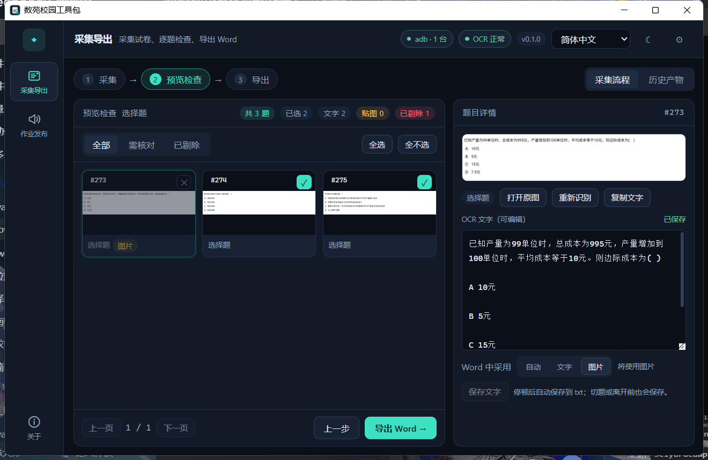

# 数苑校园工具包（Sciyardcampus Kit）

把「数苑校园」试卷预览里的题目从安卓模拟器采集下来，**逐题检查**后导出成 Word 题库。

这是 [Sciyardcampus_file_export](https://github.com/FantasySilence/Sciyardcampus_file_export)
的桌面版：保留原来的切题 / OCR / Word 算法，把命令行菜单换成 **pywebview + Vue 3** 的三步界面，
并增加可取消的任务、实时日志、预览剔除和单题重识别。



## 功能

- **采集**：整卷一次滚到底，或按题型采集；复用上游的红色标题定位、页脚完整性判断、题号去重、滚动对齐。
- **自动 OCR**：采集完成自动接着识别文字，公式 / 表格 / 图像题打标签。
- **预览检查**：逐题看截图 + OCR 文字；文字可直接编辑并自动写回 txt；可剔除、可单题重新识别。
- **每题选择呈现方式**：Word 里用「自动 / 文字 / 图片」；自动 = 有公式/表格/图像标签贴图，纯文字转正文。
- **导出 Word**：按每题选择生成；导出前可改文件名、确认覆盖。
- **历史**：本应用的检查会话持久化；没有会话的旧产物也能合成只读会话，继续预览 / 导出。
- **环境自检**：adb / Tesseract 状态灯，一键 `adb connect`，数据目录可切换。
- **作业发布**：占位页 + 后端插件骨架，本期不接真实接口。

## 环境要求

| 项目 | 要求 |
|---|---|
| 操作系统 | Windows 10 / 11 |
| Python | 3.12（开发时使用 3.12.7） |
| WebView2 | Microsoft Edge WebView2 Runtime（Win11 一般已自带） |
| 模拟器 | 推荐 MuMu 模拟器 12，画面 **1600×900**、DPI 240、横屏 |
| OCR | Tesseract 5.x，需要 `chi_sim`、`eng` 语言包 |
| 前端构建 | Node.js 20+（只有改前端 / 重新打包时需要） |

Tesseract 下载：<https://github.com/UB-Mannheim/tesseract/wiki>，安装时勾选 Chinese (Simplified)。

## 安装与运行

```powershell
# 1. 工作区虚拟环境（已建好的话跳过）
py -3.12 -m venv .venv

# 2. 依赖
.venv\Scripts\python.exe -m pip install -r requirements-dev.txt

# 3. 前端构建（首次运行 / 改前端后）
cd web
npm install
npm run build
cd ..

# 4. 启动
.venv\Scripts\python.exe main.py
```

开发时可以用 Vite 热更新：

```powershell
# 终端 1
cd web; npm run dev

# 终端 2
.venv\Scripts\python.exe main.py --dev --debug
```

## 模拟器配置（MuMu）

1. 安装 MuMu 模拟器 12，设置 → 显示：分辨率 **1600×900**、DPI **240**、横屏；
2. 登录数苑校园，打开「试卷预览」；
3. 如果 `adb devices` 是空的，点应用里的 **连接**：默认地址 `127.0.0.1:16384`；
4. 重启模拟器后 adb 连接会失效，需要重新点一次「连接」（或手动 `adb connect 127.0.0.1:16384`）。

adb 不用单独装：应用会先找设置里的路径，再找 `PATH`，最后找 MuMu 常见安装目录
（`...\MuMuPlayer\nx_device\<版本>\shell\adb.exe`）。

## 使用流程

1. **采集**：选整卷 / 单题型，填卷名、题量，点「开始采集」。开始后先等几秒（预热），
   让模拟器画面切到前台；采集完会自动 OCR。
2. **预览检查**：逐题核对。含公式 / 表格 / 图像的题会标黄，建议对照原图；
   识别差的题可以「重新识别」；不要的题点右上角勾选剔除。
3. **导出**：确认文件名，点「导出 Word」；完成后可直接打开文件或所在目录。

数据默认放在**应用目录**：

- **源码运行**：仓库根目录。产物在 `resources/`，配置在 `.scikit/`，与上游布局一致；
- **exe 运行**：exe 所在目录。`resources/`、`.scikit/` 都放在 exe 同级。

```
<应用目录>/
├─ resources/
│  ├─ row_pngs/<题型>/*.png
│  ├─ row_txt/<题型>/*.txt
│  ├─ row_paper/<卷名>/pngs|txts/
│  └─ word_output/*.docx
└─ .scikit/            # 设置、备份、会话、缩略图、OCR 临时文件、WebView 缓存
```

数据目录可以在 **设置 → 数据与存储 → 更改位置** 里自定义；换目录后
`resources/` 与 `.scikit/` 会一起搬到新位置。也可以直接指向已有的
`Sciyardcampus_file_export` 项目，复用其中现成的题目。

## 打包

```powershell
powershell -ExecutionPolicy Bypass -File packaging\build.ps1
# 产物：dist\Sciyardcampus_Kit\Sciyardcampus_Kit.exe
```

PyInstaller 使用 onedir 模式；`web/dist` 与 `resources` 会一起打包，运行时不需要 Node。
Tesseract 仍是外部依赖，首次使用前在设置里指定路径即可。

## 开发

```powershell
# 后端测试
.venv\Scripts\python.exe -m pytest tests -q

# 只跑不依赖 Tesseract 的测试
.venv\Scripts\python.exe -m pytest tests -q -m "not ocr"

# 前端类型检查 + 构建
cd web
npx vue-tsc --noEmit
npm run build
```

代码结构：

```
src/scikit/
├─ const.py                 全项目唯一的常量表（窗口/路径/设备/算法/默认设置）
├─ app.py / api.py          窗口、静态服务、媒体路由、JS 桥
├─ jobs.py                  后台任务：进度、日志、取消
├─ session.py               检查会话：预览与导出的唯一数据源
├─ env.py                   adb / Tesseract / 数据目录自检
├─ platform/                与业务无关的注册表、设置、存储
├─ device/                  adb / 鼠标通道
├─ pipeline/                切题、OCR、文字整理、Word、产物扫描
└─ tools/export|publish/    插件式工具（manifest + actions）
web/src/tools/export/       三步界面 + 历史面板
web/src/tools/publish/      占位页
```

> 调整默认值/阈值只改 `src/scikit/const.py`；其它模块一律 `from scikit import const`。

## 已知限制

- 只支持 Windows；依赖 WebView2 与 Win32 的窗口 / DPI 接口。
- 识别依赖数苑试卷页面的固定版式（红色「（x分）」标题行 + 浅灰页脚）。
- 公式、表格、图形题默认在 Word 里是**原图**，不是可编辑公式；可以在预览里改成文字，但 OCR 不保证准确。
- 比一屏还高的题会跳过并提示，需要手动补截。
- 作业发布尚未实现，只有占位页。

## 归属与许可

- 业务逻辑来自 [Sciyardcampus_file_export](https://github.com/FantasySilence/Sciyardcampus_file_export)（MIT）；
- 界面与插件框架参考 [LSP_PlayerKit](https://github.com/FantasySilence/LSP_PlayerKit)（GPLv3，作者同为 Fantasy_Silence）；
- 详见 [NOTICE](NOTICE)。

如果对外分发，请先确认 LSP_PlayerKit 的 GPLv3 与本项目许可证的兼容性。
